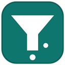

# ChannelSieve

Block unwanted channels, videos and comments on YouTube — before they ever render.

ChannelSieve filters YouTube's data as it arrives, so blocked content simply isn't there: not in your
feed, search results, sidebar, comments or autoplay. Block by channel ID, channel name, video title,
video ID or comment text, using plain keywords or regular expressions. Blocking a channel takes one
click from the three-dot menu on any video.

A maintenance fork of [BlockTube](https://github.com/amitbl/blocktube), updated to work on current
Firefox and Chrome. See [CHANGES-FORK.md](CHANGES-FORK.md) for what changed and why.

## Install

**Firefox** — download the signed `.xpi` from the
[Releases page](https://github.com/825i/channelsieve/releases) and open it in Firefox. It is signed
by Mozilla, so it installs normally with no changes to your browser settings.

**Chrome** — not published to the Web Store because Google makes it a pain. Build it and load it unpacked:

```
.\tools\build.ps1 -Browser chrome     # Windows
./tools/build.sh chrome               # Linux / macOS
```

Then load `dist/chrome/` via **Load unpacked** at `chrome://extensions`.

## First run on Firefox

Two one-time steps, both normal for Manifest V3 extensions:

* **Allow it on YouTube.** Open the ChannelSieve popup and click **Grant access to YouTube**, or use
  `about:addons` → ChannelSieve → **Permissions**. Firefox does not always grant site access at
  install, and without it the extension cannot see YouTube at all.
* **Pin the icon.** Firefox puts new extension buttons inside the puzzle-piece menu rather than the
  toolbar. Right-click ChannelSieve there → **Pin to Toolbar**. Settings are also always available at
  `about:addons` → ChannelSieve → **Preferences**.

Reload any open YouTube tab afterwards.

## Blocking channels

Click the three dots on any video → **Block Channel**.

To add many at once, open Options → **Channel ID** and paste one per line. A channel's ID is the
`UC…` string in its URL: `youtube.com/channel/UCxxxxxxxxxxxxxxxxxxxxxx`. IDs never change, unlike
channel names, so they are the reliable way to block a specific channel.

Options → **Export** saves your filters to a file; **Import** restores them.

## Building

Plain JavaScript with no toolchain to install — the build copies the sources, substitutes the version
and zips the result.

```
git clone https://github.com/825i/channelsieve
cd channelsieve

.\tools\build.ps1 -Browser firefox    # Windows
./tools/build.sh firefox              # Linux / macOS
```

Output lands in `dist/`. Icons are generated by `tools/make-icons.ps1`.

## Thanks

To [amitbl](https://github.com/amitbl), who wrote [BlockTube](https://github.com/amitbl/blocktube) and maintained it for almost 8 years.
The filtering engine is their work; this fork only fixes how it loads on Firefox and Chrome.

## License

GPLv3 — see [LICENSE](LICENSE).
